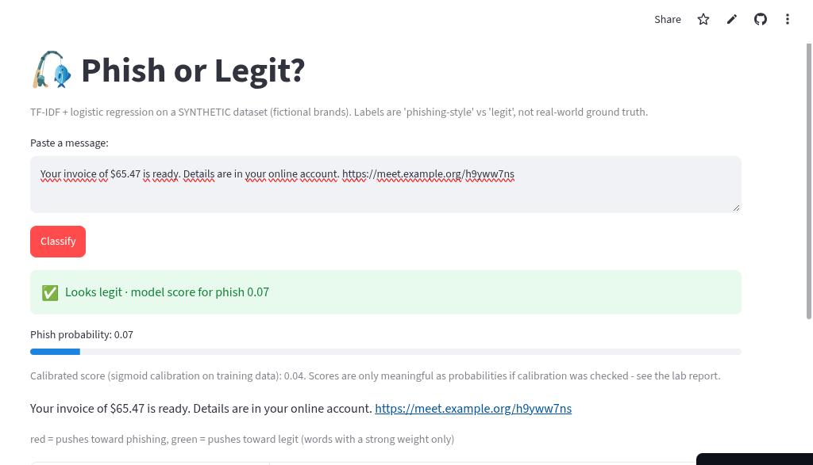

# Lab 04 : Phish or Legit? Report



## Purpose

This project builds a text classifier that decides whether a short message is
**phishing-style** or **legit**, using a synthetic dataset of fictional-brand
messages. It is an educational lab (not a production detector): the goal is to
show the full pipeline - data, features, model, evaluation, calibration, and
explainability - and why accuracy alone is misleading on imbalanced data.

## Dataset

- `data/messages.csv` - 2000 synthetic messages, 20% phishing / 80% legit.
- Fictional brands (Northbank, ParcelGo, Civic Savings, …); URLs, money amounts
  and numbers are normalised to placeholder tokens (`urltok`, `moneytok`, `numtok`).
- Stratified split: 1500 train / 500 test, keeping the 20% phishing rate in both.

## Methodology

- Features: TF-IDF (word unigrams+bigrams, sublinear tf, min_df=2).
- Models compared: Naive Bayes, Logistic Regression, NB + sigmoid calibration,
  LR + char n-grams (extension).
- All fitting happens inside a single scikit-learn `Pipeline` on the **train**
  split only, to avoid data leakage.
- Split is seeded (SEED=42) and stratified.

## Results (test set, 500 messages)

| Model | Precision | Recall | F1 | Accuracy | Brier | ECE |
|---|---|---|---|---|---|---|
| Naive Bayes | 0.611 | 0.800 | 0.693 | 0.858 | 0.104 | 0.089 |
| Logistic Regression | 0.747 | 0.710 | 0.728 | 0.894 | 0.071 | 0.035 |
| NB + calibration | 0.694 | 0.750 | 0.721 | 0.884 | 0.086 | 0.030 |
| LR + char n-grams | 0.777 | 0.730 | 0.753 | 0.904 | 0.064 | 0.050 |

Majority-class baseline accuracy (always "legit"): **80.0%** - which is why
accuracy alone is misleading; F1 / precision / recall on the phish class matter.

### Confusion matrix (Logistic Regression)

Rows = truth, columns = prediction (legit, phish):

```
[[376  24]
 [ 29  71]]
```

### Decision threshold trade-off (Logistic Regression)

| Threshold | Precision | Recall | F1 |
|---|---|---|---|
| 0.20 | 0.604 | 0.930 | 0.732 |
| 0.35 | 0.672 | 0.800 | 0.731 |
| 0.50 | 0.747 | 0.710 | 0.728 |
| 0.70 | 0.893 | 0.500 | 0.641 |
| 0.90 | 1.000 | 0.090 | 0.165 |

Lowering the threshold catches more phishing (higher recall) at the cost of more
false alarms; raising it does the opposite.

### Strongest features (Logistic Regression)

- Phish: `urltok` (4.83), `immediately` (3.98), `notice` (3.60),
  `immediately urltok` (3.17), `alert` (2.82), `can urltok` (2.81)
- Legit: `reminder` (-2.77), `hey` (-2.52), `numtok` (-2.28), `fyi` (-2.01),
  `order` (-1.63), `order numtok` (-1.63)

### Failure cases

- False negatives (phish → legit): 29
- False positives (legit → phish): 24

See `results/failures.txt` for examples. Common failure: phishing messages that
mimic legit tone ("Your Civic Savings account has a new notice…") slip through.

## Calibration

Brier score and ECE show how well scores behave as probabilities. Logistic
Regression (ECE 0.035) is better calibrated than Naive Bayes (ECE 0.089);
sigmoid calibration improves NB further. The app shows both the raw model score
and a sigmoid-calibrated score. Scores are only meaningful as probabilities if
calibration was checked - see the reliability diagram in `results/phish_results.png`.

## Explainability in the app

For each classified message, the app:
1. Shows the predicted label and score (plus calibrated score).
2. Highlights words that strongly push toward phish (red) or legit (green).
3. Lists the top contributing features to the log-odds.

## How to run

```bash
pip install -r requirements.txt
streamlit run app.py          # UI
python -m src.evaluate        # metrics + plots in results/
```

## Files

- `app.py` - Streamlit UI
- `src/pipeline.py` - data loading, model building, prediction, explanations
- `src/evaluate.py` - metrics, confusion matrix, calibration, failure cases
- `data/messages.csv` - synthetic dataset
- `data/make_data.py` - dataset generator
- `results/` - metrics.json, failures.txt, phish_results.png

## Limitations

- Synthetic data with fictional brands; not real-world ground truth.
- Small dataset; models may not generalise to real phishing.
- Word-level highlighting only covers tokens with a strong weight (|w| > 0.3).
- Calibrated scores assume the training distribution matches deployment.
"""